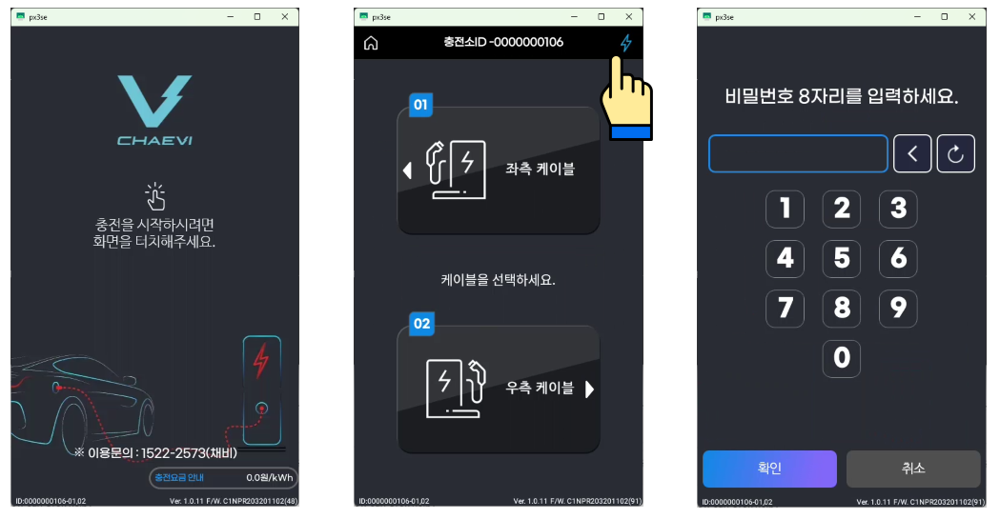
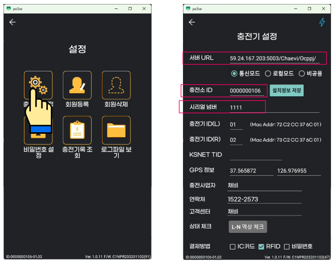
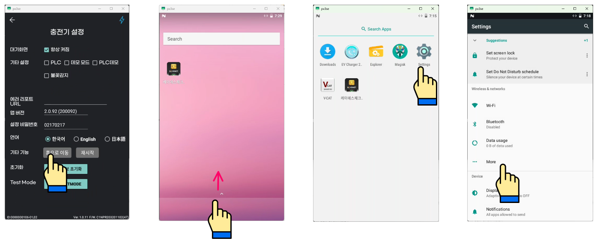
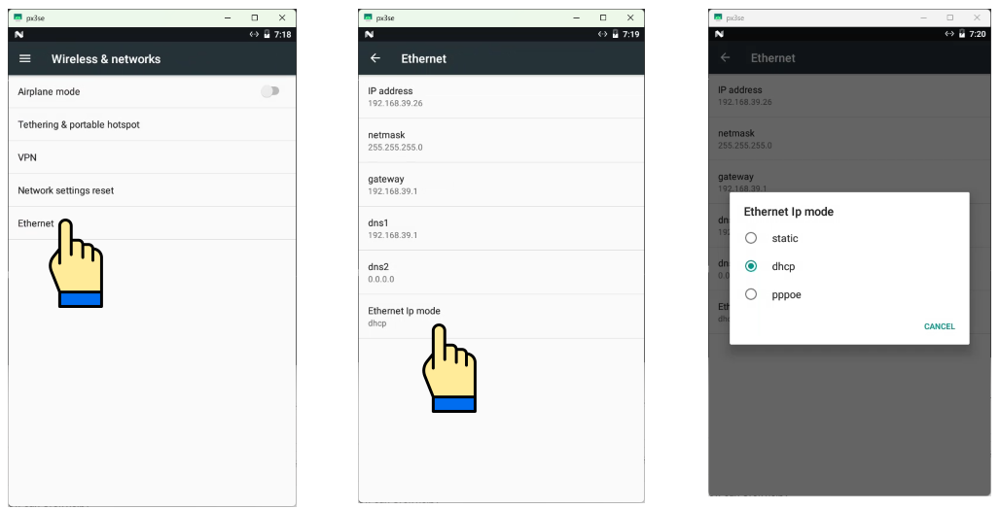

# 충전기 네트워크 설정 가이드

**전기차 충전기 네트워크 설정 가이드**

Network Configuration Guide

> **설정 개요**
>
> 이 가이드는 캐스트프로 전기차 충전기의 서버 URL, 충전소 ID, 네트워크(IP) 설정 방법을 안내합니다.
>
> **적용 대상:**  캐스트프로 전기차 충전기 (채비 앱 연동 모델)
>
> **소요 시간:**  약 5~10분

## 설정 절차

### Step 1 설정 진입 (관리자 메뉴 접속)

- 충전기 화면을 터치합니다.
- 충전기 화면 우측 상단의 번개(⚡) 아이콘을 2초 이상 길게 누릅니다.
- 비밀번호 8자리를 입력합니다: `021*****`  →  확인을 누릅니다.

> **※ 참고**  비밀번호는 관계자 외 공유를 삼가 주시기 바랍니다.

### Step 2 충전기 설정 (서버 URL / 충전소 ID / 시리얼 넘버 변경)

- 설정 메뉴에서 '충전기 설정'을 선택합니다.
- 서버 URL, 충전소 ID, 시리얼 넘버를 해당 현장 정보에 맞게 변경합니다.
- 통신 모드(통신모드 / 로컬모드 / 비공용)를 선택합니다.
- 변경 완료 후 '설치정보 저장' 버튼을 눌러 저장합니다.

### Step 3 네트워크 설정 진입

- 충전기 설정 화면 하단의 '홈으로 이동'을 선택합니다.
- Android 홈 화면 하단에서 위쪽으로 스와이프하여 앱 목록을 불러옵니다.
- 앱 목록에서 'Settings'를 선택합니다.
- Settings 화면에서 'More'를 선택합니다.

### Step 4 IP 주소 설정 (Ethernet)

- Wireless & networks 화면에서 'Ethernet'을 선택합니다.
- Ethernet 화면 하단의 'Ethernet Ip mode'를 선택합니다.
- IP 모드를 선택합니다: DHCP(자동) 또는 Static(수동).
- Static 선택 시: IP address / netmask / gateway / dns 정보를 직접 입력합니다.

> **※ 참고**  Static IP 설정 시 현장 네트워크 담당자에게 IP 정보를 확인한 후 입력하시기 바랍니다.

### 문의처

| 담당자 | 캐스트프로 연구소 |
|---|---|
| **전화** | 070-4855-2090 |
| **이메일** | rnd@castpro.kr |
