# 충전기 USB 앱 업데이트 가이드

**전기차 충전기 앱 업데이트 설치 가이드**

App Update Installation Guide

> **업데이트 개요**
>
> 이 가이드는 캐스트프로 전기차 충전기의 앱(APK)을 USB를 이용하여 업데이트하는 방법을 안내합니다.
>
> **준비물:**  USB 드라이브 1개, 업데이트 APK 파일 (APP\_200101.apk 또는 최신 버전)
>
> **소요 시간:**  약 5~10분

## 업데이트 절차

### Step 1 APK 파일을 USB에 복사

1. 이메일로 전달받은 APK 파일(APP\_200101.apk)을 컴퓨터에 저장합니다.
2. USB 드라이브를 컴퓨터에 연결하고 APK 파일을 USB 루트 경로에 복사합니다.
3. 복사 완료 후 USB를 컴퓨터에서 안전하게 제거합니다.

### Step 2 충전기 케이스 열기

1. 충전기 본체의 케이스를 엽니다.
2. 내부 Android 보드가 보이면 준비가 된 것입니다.

### Step 3 USB 연결

1. 충전기 내부 Android 보드의 빈 USB 포트를 확인합니다.
2. 아래 사진의 주황색 박스 위치에 USB를 연결합니다.

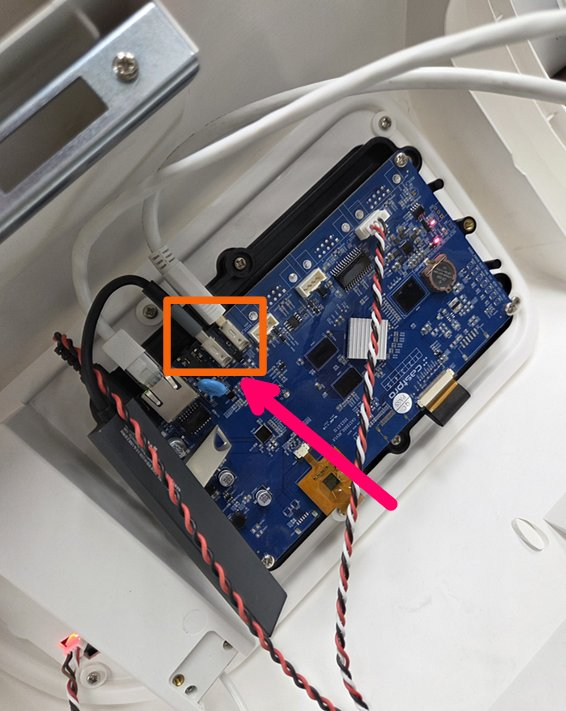

### Step 4 관리자 메뉴 진입

1. 충전기 화면(왼쪽)이 아래와 같이 표시됩니다.
2. 오른쪽 화면처럼 오른쪽 상단의 번개(⚡) 아이콘을 3초 이상 길게 누릅니다.
3. 비밀번호 입력 화면이 나타납니다.

| 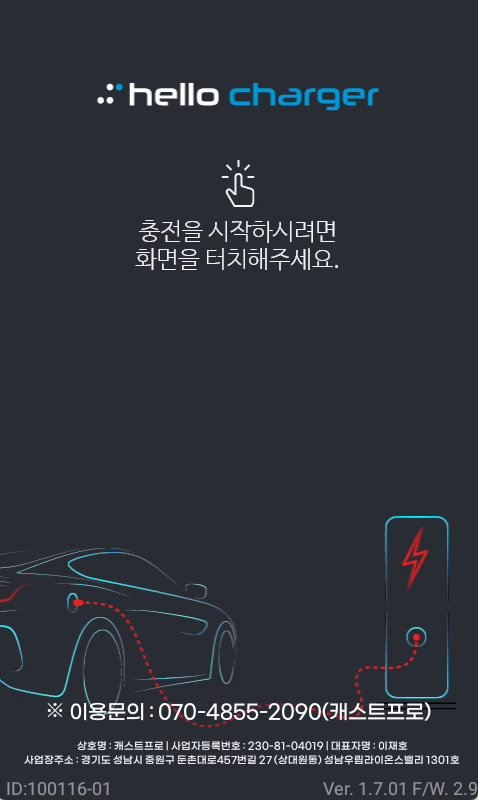 | 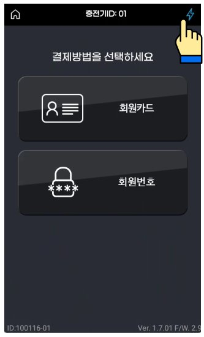 |
|---|---|

### Step 5 비밀번호 입력

1. 아래와 같이 비밀번호 8자리 입력 화면이 나타납니다.
2. 비밀번호를 입력합니다: `021*****`
3. 확인 버튼을 누릅니다.

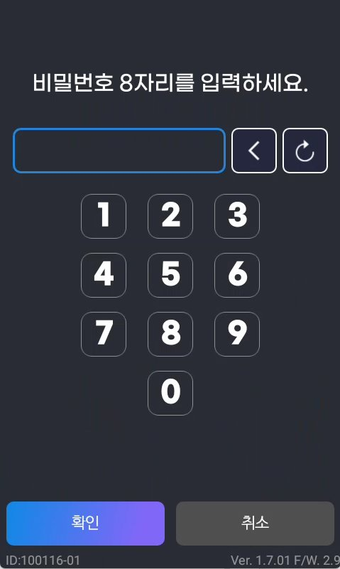

> **※ 참고**  비밀번호는 관계자 외 공유를 삼가 주시기 바랍니다.

### Step 6 충전기 설정 > 홈으로 이동

1. 로그인 후 설정 메뉴(첫 번째 화면)가 나타나면 '충전기 설정'을 선택합니다.
2. 충전기 설정 화면(두 번째)에서 화면을 위쪽으로 스크롤한 뒤 '홈으로 이동'을 누릅니다.
3. 세 번째 화면처럼 확인 팝업이 나타나면 '확인'을 누릅니다.

| 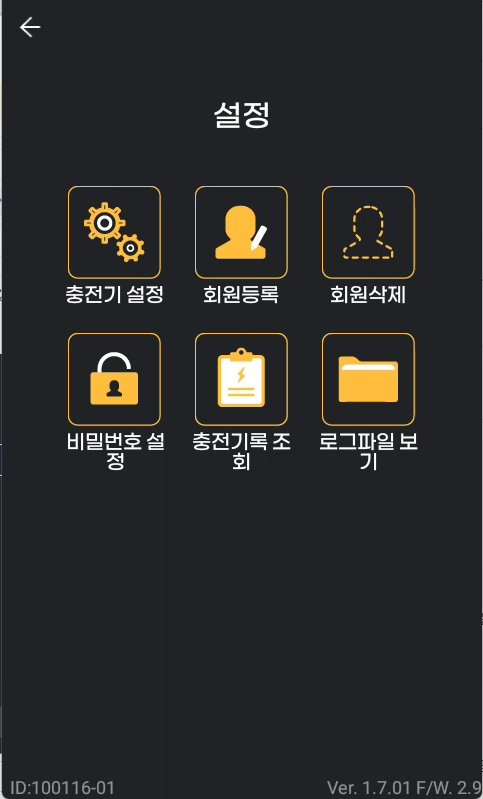 | 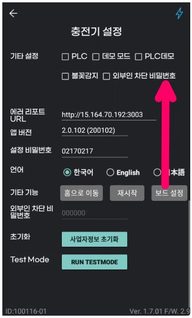 | 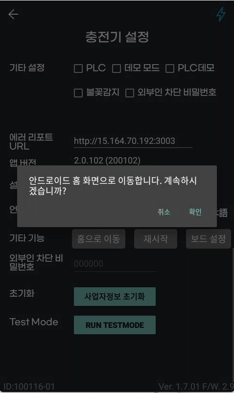 |
|---|---|---|

### Step 7 파일 탐색기(Explorer) 실행 후 USB 선택

1. 홈 화면 하단에서 위로 스와이프하여 앱 목록을 불러옵니다. (첫 번째 화면)
2. 앱 목록에서 'Explorer'를 선택합니다. (두 번째 화면)
3. Explorer에서 'USB'를 선택합니다. (세 번째 화면)

| 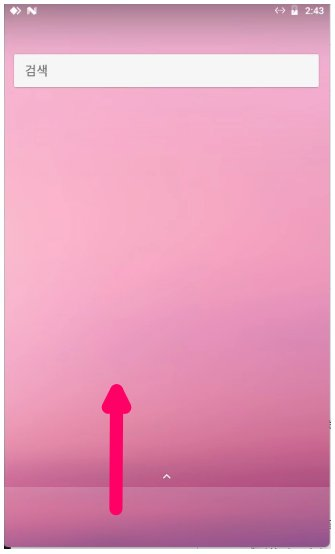 | 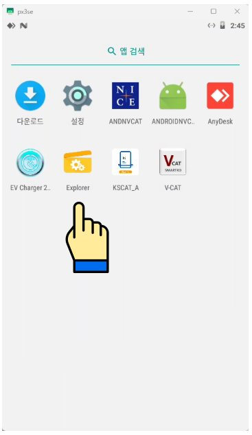 | 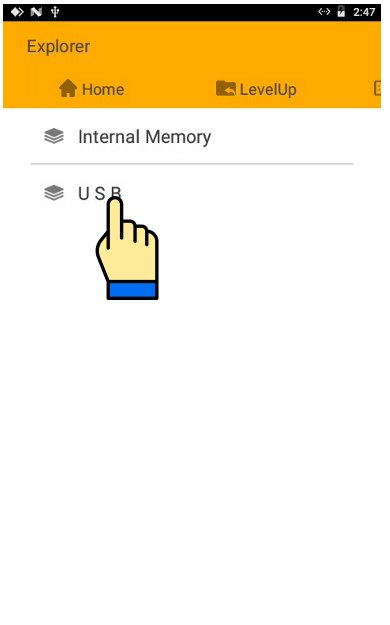 |
|---|---|---|

### Step 8 APK 파일 선택 및 설치

1. USB 내 파일 목록에서 APK 파일(APP\_200101.apk)을 선택합니다. (첫 번째 화면)
2. 앱 업데이트 확인 팝업에서 '설치'를 누릅니다. (두 번째 화면)
3. 설치가 완료될 때까지 기다립니다. (세 번째 화면)

| 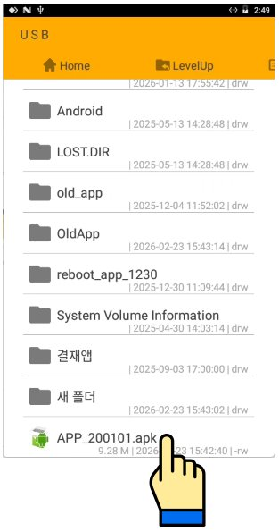 | 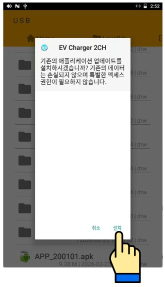 | 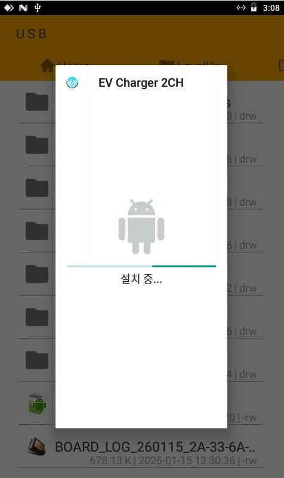 |
|---|---|---|

### Step 9 USB 제거 및 완료 확인

- 설치 완료 후 USB 드라이브를 충전기에서 제거합니다.
- 충전기 케이스를 닫습니다.
- 충전기 화면의 버전 정보(충전기 설정 > 앱 버전)에서 업데이트가 정상 적용되었는지 확인합니다.

### 문의처

| 담당자 | 캐스트프로 연구소 |
|---|---|
| **전화** | 070-4855-2090 |
| **이메일** | rnd@castpro.kr |
