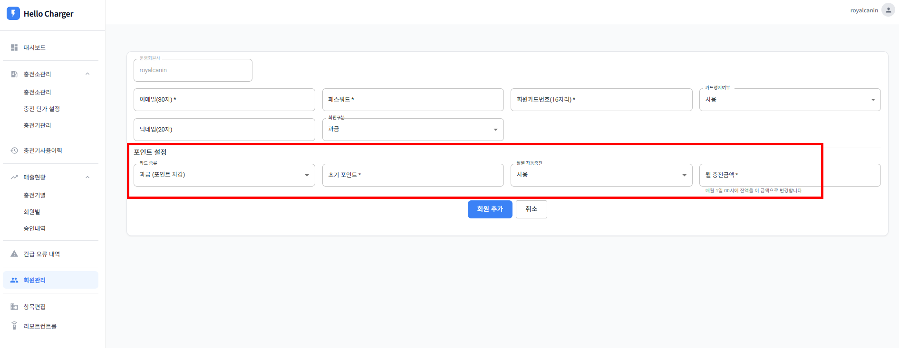
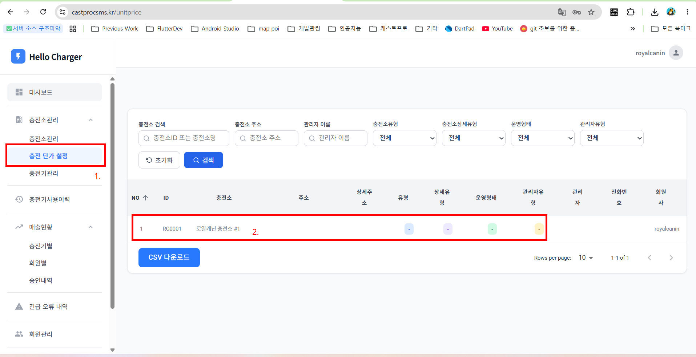
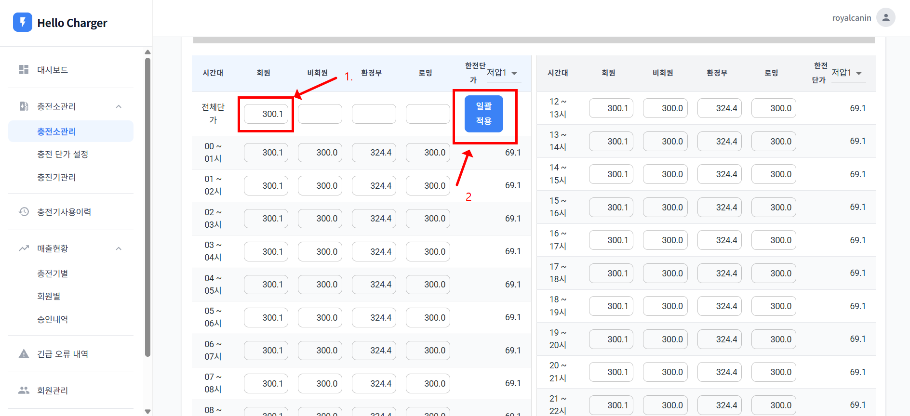
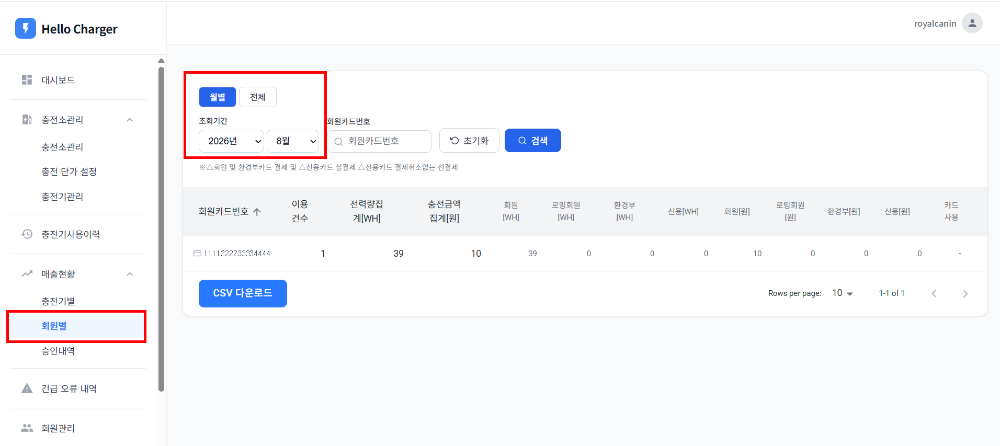

# 로얄캐닌 포인트 충전 설치 가이드

**HelloCharger Dashboard 운영 가이드 | 로얄캐닌 편**

*Royal Canin Point Charging Setup Guide | Ver 1.0 (2026.09.18)*

> **시스템 개요**
>
> **접속 주소:** https://castprocsms.kr/sign-in#/  (브라우저: Chrome 권장)
>
> **대시보드 ID:** `royal*****`
>
> **대시보드 PW:** `*****`
>
> **충전소:** RC0001
>
> **충전기 번호:** 01 / 02 / 03 / 04

## Part 1. 대시보드 접속

### 1.1 로그인

- 브라우저에서 https://castprocsms.kr/sign-in#/ 에 접속합니다.
- ID(`royal*****`)와 PW(`*****`)를 입력 후 로그인합니다.

## Part 2. 회원 추가 (포인트 충전 설정)

### 2.1 회원 추가

- 왼쪽 탭에서 '회원관리'를 클릭합니다.
- 우측 상단의 '회원 추가' 버튼을 클릭합니다.
- 필수 항목(이메일, 패스워드, 회원카드번호 등)을 입력합니다.
- 포인트 설정
  - 카드 종류: 과금(포인트 차감) 선택
  - 초기 포인트: 50,000원 입력
  - 월별 자동충전: '사용' 선택 시 매월 1일 00시에 잔액이 설정한 월 충전금액으로 자동 변경됨
- 입력을 완료한 후 '회원 추가' 버튼을 클릭하면 등록이 완료됩니다.

*포인트 설정 영역 (카드종류 / 초기 포인트 / 월별 자동충전 / 월 충전금액)*

## Part 3. 충전 단가 설정

### 3.1 충전소 선택

- 왼쪽 탭 충전소관리 하위의 '충전 단가 설정'을 클릭합니다.
- 목록에서 '로얄캐닌 충전소 #1'(ID: RC0001)을 선택합니다.

*① 충전 단가 설정 메뉴  ② 로얄캐닌 충전소 선택*

### 3.2 일괄 적용

- 상단 '전체단가' 행의 '회원' 칸에 적용할 단가를 입력합니다.
- '일괄적용' 버튼을 클릭하면 입력한 단가가 모든 시간대(00~24시)에 한 번에 적용됩니다.
- ※ 비회원 / 환경부 / 로밍 등 다른 요금도 동일한 방식으로 '전체단가' 칸에 입력 후 일괄적용할 수 있습니다.

*① 전체단가 입력  ② 일괄적용 버튼 클릭 → 모든 시간대에 동일 단가 반영*

## Part 4. 충전기 설정

### 4.1 앱 설치

- 충전기에 Hello Charger 앱 2.0.115 버전 설치가 필요합니다.
- 다운로드: https://board.worksmobile.com/main/article/4070000000206314311?boardNo=4070000000139439115

### 4.2 충전기 초기 설정

- 충전기 초기 화면에서 사업자 '로얄캐닌'을 선택합니다.
- 설정 > 충전기 설정 > 기타설정 > '회원카드 충전'을 선택합니다.

## Part 5. 매출현황 - 회원별 사용 이력

### 5.1 조회 방식

- 왼쪽 탭 매출현황 하위의 '회원별'을 클릭합니다.
- '월별' 선택 시 조회기간에서 연도와 월을 지정하며, 해당 월의 사용 이력만 확인할 수 있습니다.
- '전체' 선택 시 기간을 직접 설정할 수 있어, 원하는 기간 범위의 사용 이력을 조회할 수 있습니다.

*월별 / 전체 조회 방식 선택 및 조회기간 설정 영역*
