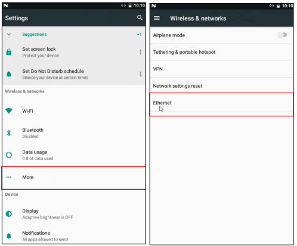
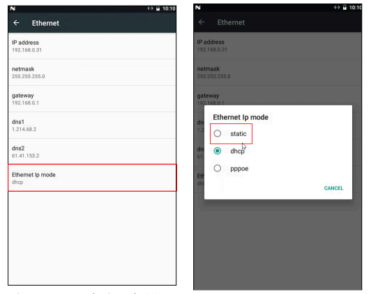
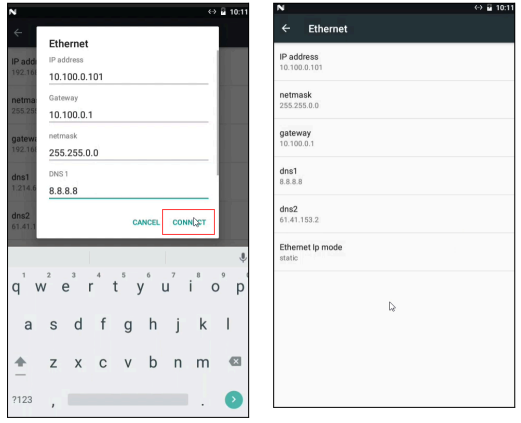
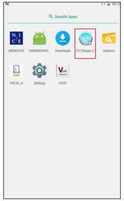
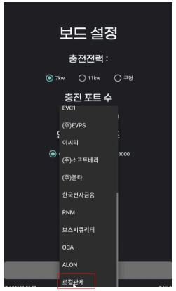
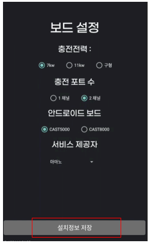
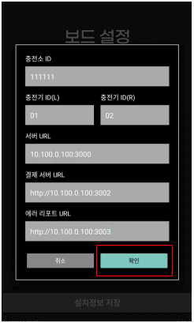
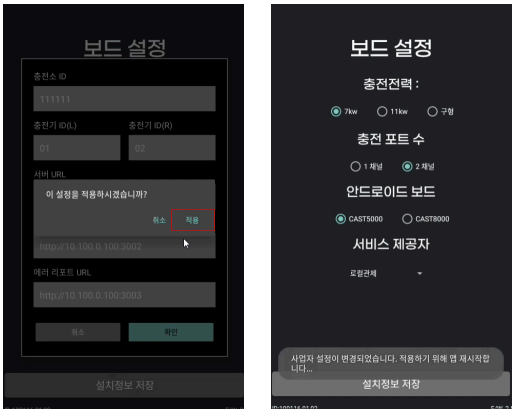

# 로컬 서버용 충전기 설정 가이드

**로컬 서버 사용 매뉴얼 충전기 설정 가이드**

Local Server Setup Manual for EV Charger

> **매뉴얼 개요**
>
> 이 가이드는 캐스트프로 전기차 충전기를 로컬 서버 환경에서 사용하기 위한 네트워크 및 펌웨어 초기 설정 방법을 안내합니다.
>
> **버전:**  V1.0  (2025.05.23)
>
> **구성:**  1. 안드로이드 네트워크 설정 변경   2. 충전기 펌웨어 초기 설정

## Part 1. 안드로이드 네트워크 설정 변경

### Step 1-1 Settings 앱 실행 후 Ethernet 설정 진입

- 'Settings' 앱 아이콘을 클릭합니다.
- Settings 화면에서 'More'를 선택합니다.
- Wireless & networks 화면에서 'Ethernet'을 선택합니다.

### Step 1-2 Ethernet IP mode를 'static'으로 변경

- Ethernet 화면 하단의 'Ethernet Ip mode'를 선택합니다.
- 팝업에서 'static'을 선택합니다.

### Step 1-3 고정 IP 및 네트워크 정보 입력

- 로컬 서버 관리자가 지정한 고정 IP, Gateway, Netmask, DNS를 입력합니다.
- 'CONNECT' 버튼을 클릭하면 static IP가 적용됩니다.
- 설정 완료 후 Ethernet 화면에서 입력한 정보를 확인합니다.

> **🚨 주의사항**
>
> IP 주소 고유성: 설치되는 충전기별로 IP 주소를 모두 다르게 설정해야 합니다. IP 주소가 중복되면 통신 오류가 발생합니다.
>
> 네트워크 종속성: 아래 정보는 현장 네트워크 구성에 따라 달라집니다. 반드시 네트워크 담당자에게 정확한 값을 확인하여 입력하세요. 임의 설정 시 통신 장애가 발생할 수 있습니다.

**▶ IP 설정 예시**

| 설정 항목 | 예시 값 |
|---|---|
| IP address | 10.100.0.101 ~ 10.100.0.104 (충전기별 고유 설정) |
| netmask | 255.255.0.0 |
| gateway | 10.100.0.1 |
| dns1 | 8.8.8.8 |
| dns2 | 61.41.153.2 |

## Part 2. 충전기 펌웨어 초기 설정

### Step 2-1 EV Charger 2 앱 실행

- 앱 목록에서 'EV Charger 2' 아이콘을 클릭하여 앱을 실행합니다.

### Step 2-2 서비스 제공자를 '로컬관제'로 선택

- '보드 설정' 화면에서 '서비스 제공자' 항목의 드롭다운을 선택합니다.
- 목록에서 '로컬관제'를 선택합니다.

### Step 2-3 설치정보 저장 클릭

- 화면 하단의 '설치정보 저장' 버튼을 클릭합니다.

### Step 2-4 로컬 관제 서버 접속 정보 입력 후 확인

- 충전소 ID, 충전기 ID(L/R)를 입력합니다.
- 로컬 서버 관리자가 지정한 서버 URL, 결제 서버 URL, 에러 리포트 URL을 입력합니다.
- '확인' 버튼을 클릭합니다.

### Step 2-5 앱 재실행 (적용)

- 팝업 알림창에서 '적용'을 누르면 설정이 저장되고 충전기 앱이 재실행됩니다.
- 재실행 후 충전기 화면이 정상적으로 표시되면 설정이 완료된 것입니다.

### 문의처

| 담당자 | 캐스트프로 연구소 |
|---|---|
| **전화** | 070-4855-2090 |
| **이메일** | rnd@castpro.kr |
