# 로컬 서버 대시보드 사용 매뉴얼

**로컬 서버 사용 매뉴얼 HelloCharger Dashboard 운영 가이드**

Local Server Operation Manual  |  Ver 1.1  (2025.08.18)

> **시스템 개요**
>
> 이 매뉴얼은 캐스트프로 로컬 서버(HelloCharger Dashboard)의 주요 화면 및 기능 사용법을 안내합니다.
>
> **접속 주소:**  http://localhost  (브라우저: Chrome 권장)
>
> **초기 아이디:**  local  (고정)
>
> **초기 비밀번호:**  local  (로그인 후 반드시 변경)

## Part 1. 로그인

### 2.1 로그인 화면

- 브라우저에서 http://localhost 에 접속합니다.
- 아이디(local)와 비밀번호를 입력 후 'LOGIN' 버튼을 클릭합니다.
- 아이디/비밀번호는 대소문자를 구분합니다.

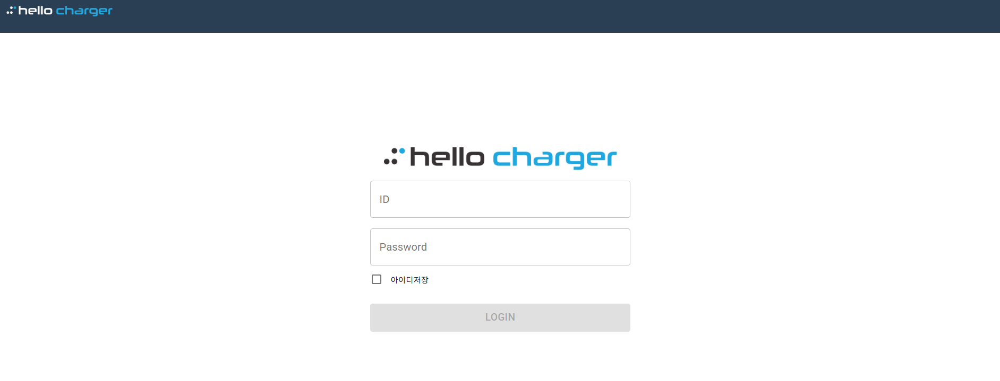

### 2.1.1 계정 비밀번호 변경

- 로그인 후 좌측 상단의 '로컬' 아이콘을 클릭합니다.
- '새 비밀번호'와 '새 비밀번호 확인'을 입력합니다.
- 환경부기관ID / 환경부기관인증키 입력 후 '수정' 버튼을 클릭합니다.

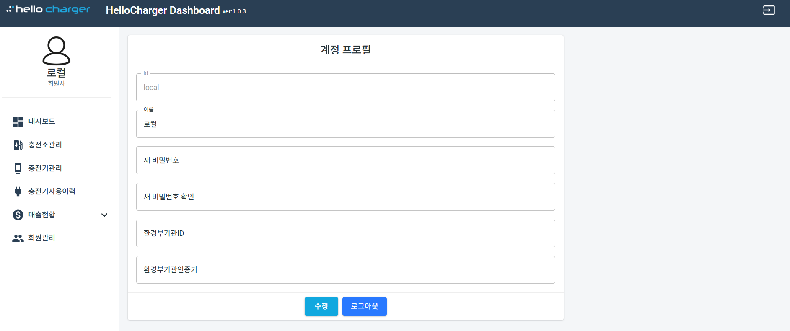

## Part 2. 대시보드

### 2.2 대시보드

- 로그인 후 기본 화면으로 대시보드가 표시됩니다.
- 등록된 모든 충전소의 현재 상태(충전중/대기 등)를 실시간으로 확인할 수 있습니다.
- 충전소 카드를 클릭하면 해당 충전소의 채널별 상세 정보를 확인할 수 있습니다.

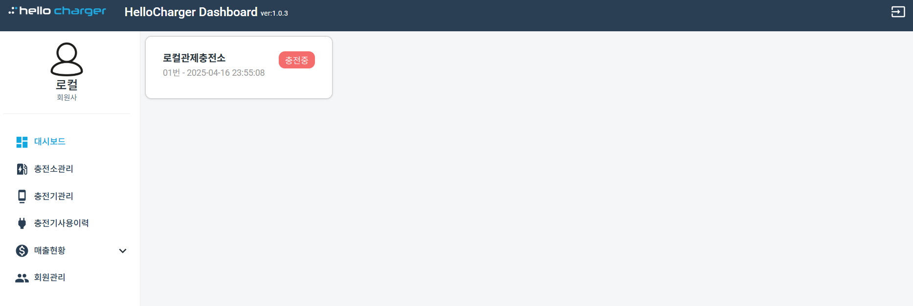

## Part 3. 충전소 관리

### 2.3 충전소 관리 목록

- 왼쪽 탭에서 '충전소관리'를 클릭합니다.
- 등록된 충전소를 실시간으로 확인할 수 있습니다.
- 충전소 이름, 충전소 ID로 검색이 가능합니다.
- CSV 다운로드 버튼으로 목록을 내보낼 수 있습니다.

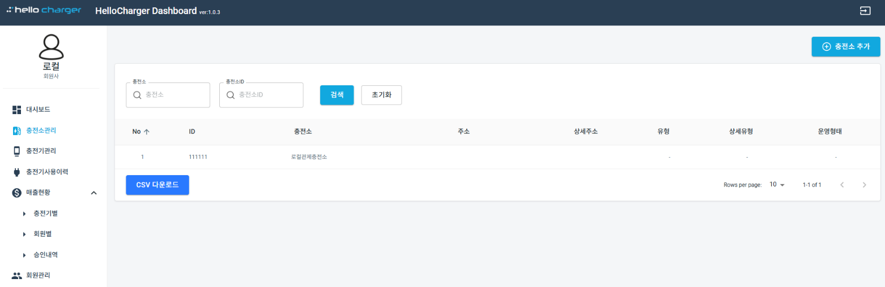

### 2.3.1 충전소 추가

- 충전소 관리 페이지 우측 상단의 '충전소 추가' 버튼을 클릭합니다.
- 필수 항목인 충전소ID(6자리 영문·숫자)와 충전소명을 입력하고 '중복체크'를 클릭합니다.
- 나머지 항목(주소, 충전소유형, 운영형태 등)을 입력합니다.
- '충전소 추가' 버튼을 클릭하면 새로운 충전소가 등록됩니다.

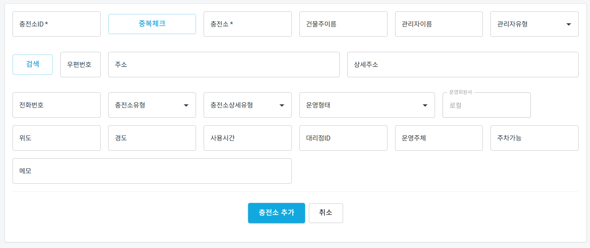

### 2.3.2 충전 단가 설정

- 왼쪽 탭에서 '충전 단가 설정'을 클릭합니다.
- 요금 설정할 충전소를 선택합니다.
- 시간대별로 회원, 비회원, 환경부, 로밍 요금을 각각 입력합니다.
- '저장' 버튼을 클릭하면 단가 설정이 완료됩니다.

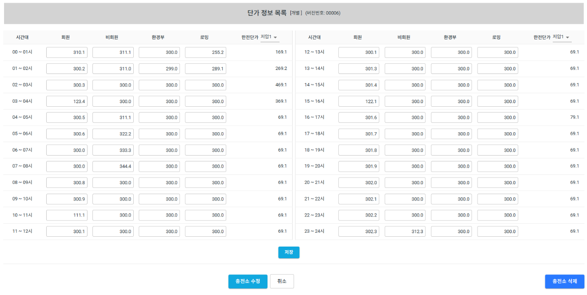

## Part 4. 충전기 관리

### 2.4.1 충전기 관리 목록

- 왼쪽 탭에서 '충전기관리'를 클릭합니다.
- 충전소, 충전소ID, 충전기 번호, 충전기 상태로 검색이 가능합니다.
- 등록된 충전기의 실시간 상태(Available 등)를 확인할 수 있습니다.

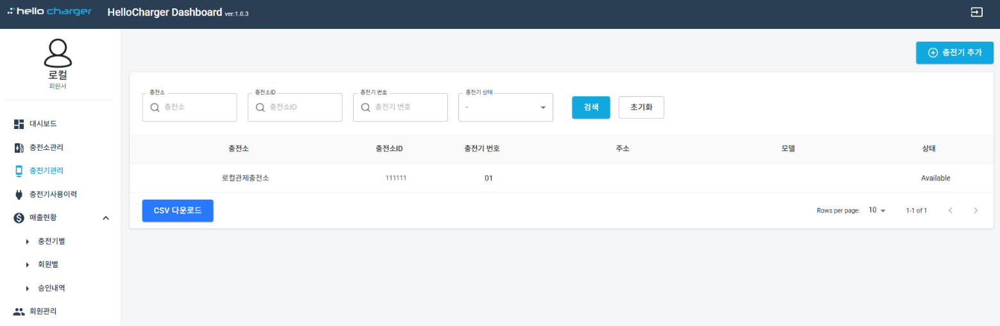

### 2.4.2 충전기 추가

- 충전기 관리 페이지 우측 상단의 '충전기 추가' 버튼을 클릭합니다.
- '충전소 검색'을 클릭하여 충전소ID(ex. 111111)를 검색하여 선택합니다.
- 충전기번호(ex. 02, 03)를 입력하고 '중복체크'를 클릭합니다.
- 자동 생성된 충전기시리얼번호의 '중복체크'도 클릭합니다.
- 충전속도(완속·중속·급속)를 선택한 후 '충전기 추가' 버튼을 클릭합니다.

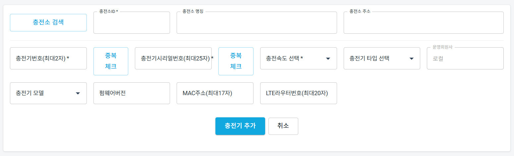

## Part 5. 충전기 사용이력 및 고장이력

### 2.5 충전기 사용이력

- 왼쪽 탭에서 '충전기사용이력'을 클릭합니다.
- 사용자, 회원카드번호, 단지/동/호수, 충전소, 충전기 번호, 충전 일시 등으로 검색할 수 있습니다.
- 충전 거래번호, 충전소, 충전량(Wh), 충전요금(원), 시작/종료 일시를 확인할 수 있습니다.

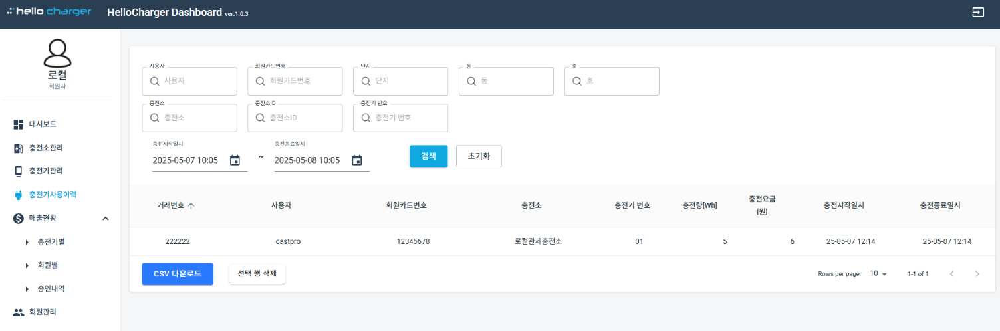

### 2.5.1 고장이력

- 왼쪽 탭 충전기관리 하위의 '고장이력'을 클릭합니다.
- 발생시간, 주체, 발생지, 오류내용 등을 통해 충전기 고장 원인을 파악할 수 있습니다.

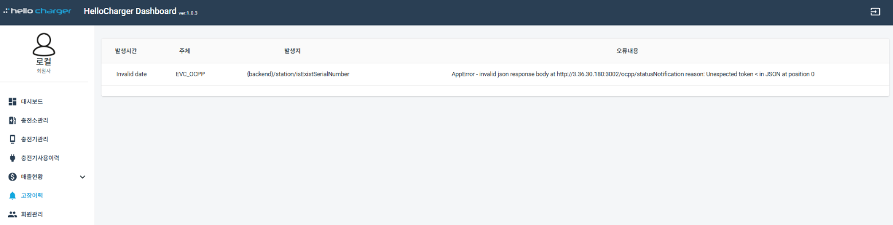

## Part 6. 매출현황

### 2.6.1 충전기 별 매출현황

- 왼쪽 탭 매출현황 하위의 '충전기별'을 클릭합니다.
- 충전소, 충전소ID, 충전기 번호, 충전 일시, 충전 금액, 충전량 등으로 검색할 수 있습니다.
- 충전소별 이용건수, 전력량합계(Wh), 충전금액합계(원)를 조회할 수 있습니다.

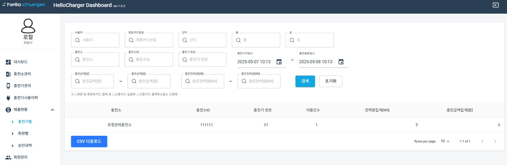

### 2.6.2 회원 별 매출현황

- 왼쪽 탭 매출현황 하위의 '회원별'을 클릭합니다.
- 사용자, 회원카드번호, 단지/동/호수, 충전소, 충전기 번호, 충전 금액 등으로 검색할 수 있습니다.
- 회원별 사용자, 차종, 차량번호, 이용건수, 전력량, 충전금액합계를 조회할 수 있습니다.

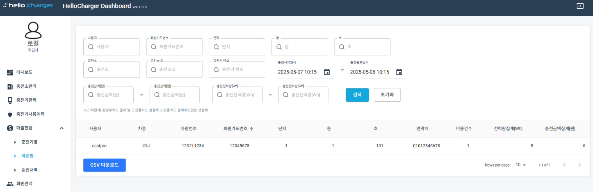

### 2.6.3 승인내역

- 왼쪽 탭 매출현황 하위의 '승인내역'을 클릭합니다.
- 거래일시, 충전소, 사용자, 회원카드번호, 승인번호, 충전량(Wh), 결제금액(원), 구분(승인/결제) 등을 조회할 수 있습니다.

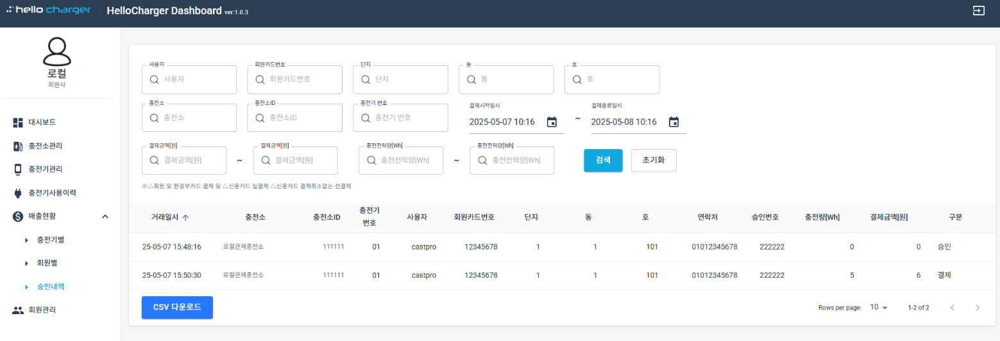

## Part 7. 회원 관리

### 2.7 회원 관리 목록

- 왼쪽 탭에서 '회원관리'를 클릭합니다.
- 사용자, 회원카드번호, 동, 호수로 검색이 가능합니다.
- 회원 목록에서 사용자, 차종, 차량번호, 회원카드번호, 단지/동/호수, 연락처, 상태를 확인할 수 있습니다.

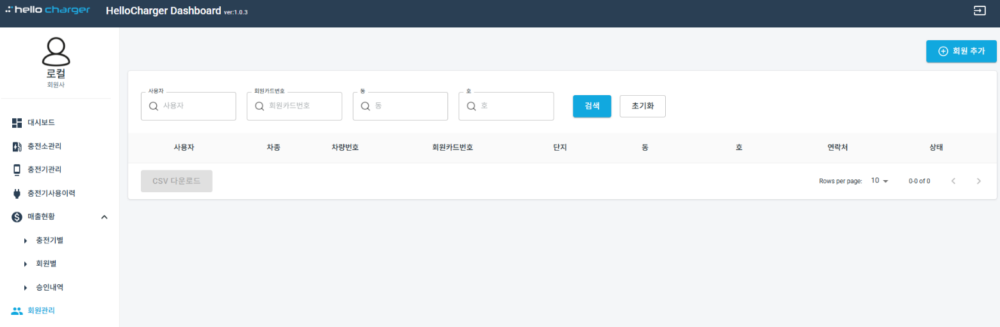

### 2.7.1 회원 추가

- 회원관리 페이지 우측 상단의 '회원 추가' 버튼을 클릭합니다.
- 필수 항목(사용자, 차종, 차량번호, 회원카드번호, 단지, 동, 호수, 연락처)을 입력합니다.
- '회원 추가' 버튼을 클릭하면 새로운 회원이 등록됩니다.

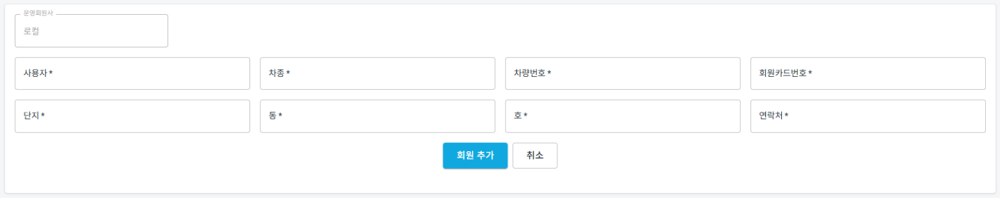

### 2.7.2 회원 수정 및 삭제

- 회원 목록에서 수정·삭제할 회원을 클릭합니다.
- 수정할 항목을 변경한 후 '수정' 버튼을 클릭합니다.
- 회원 삭제 시 우측 하단의 '회원 삭제' 버튼을 클릭합니다.

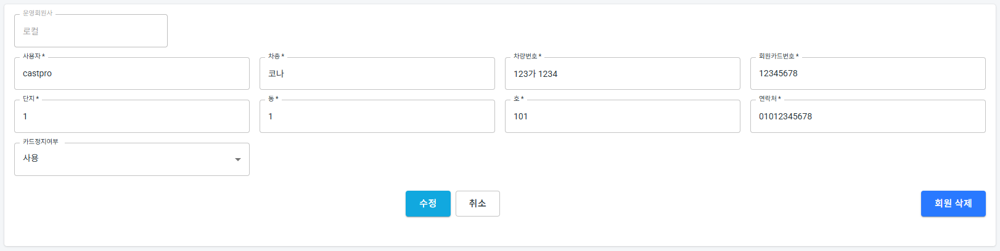

## Part 8. 항목 편집

### 2.8 항목 편집

- 왼쪽 탭에서 '항목편집'을 클릭합니다.
- 충전소관리, 충전단가설정, 충전기관리, 고장이력 등 각 페이지의 검색조건 및 메뉴 항목을 켜고 끌 수 있습니다.
- 토글 스위치로 필요한 항목만 활성화하여 화면을 사용자 편의에 맞게 커스터마이즈합니다.

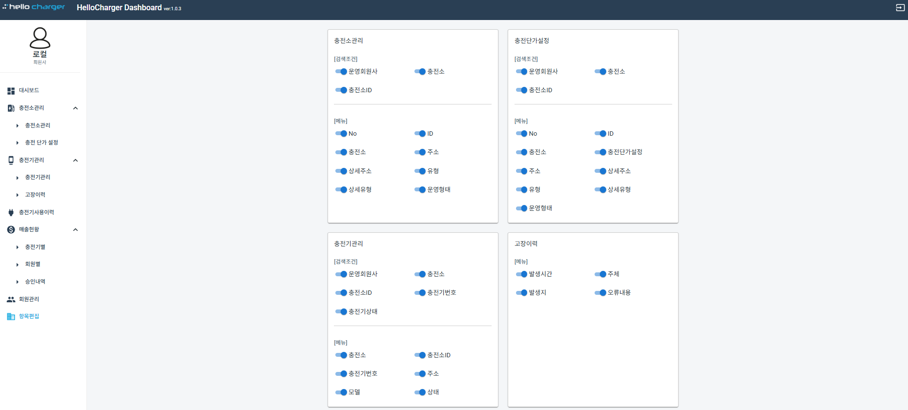

> **※ 참고**
>
> 시스템 환경: Windows XP 이상, Chrome 브라우저 권장 (Internet Explorer 9.0 이상 지원)
>
> 서버: Tomcat 5.0 이상 필요
>
> CSV 다운로드: 각 목록 페이지 하단의 'CSV 다운로드' 버튼으로 데이터를 파일로 저장할 수 있습니다.

### 문의처

| 담당자 | 캐스트프로 연구소 |
|---|---|
| **전화** | 070-4855-2090 |
| **이메일** | rnd@castpro.kr |
