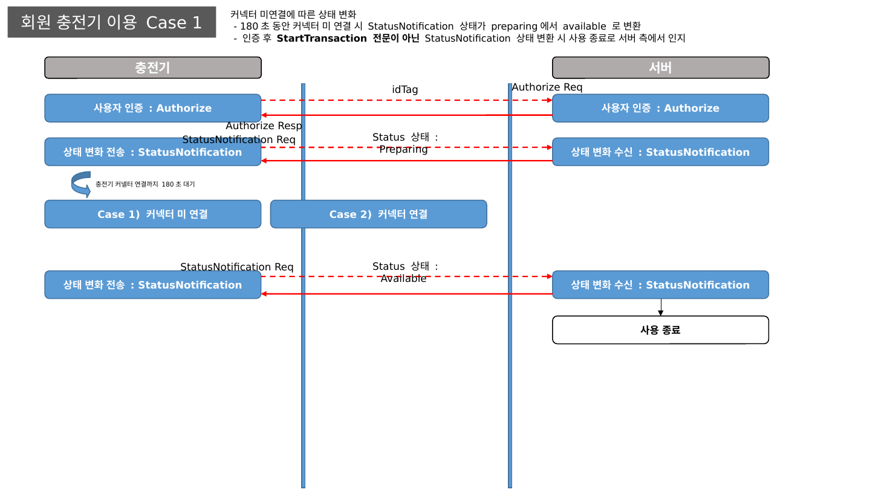
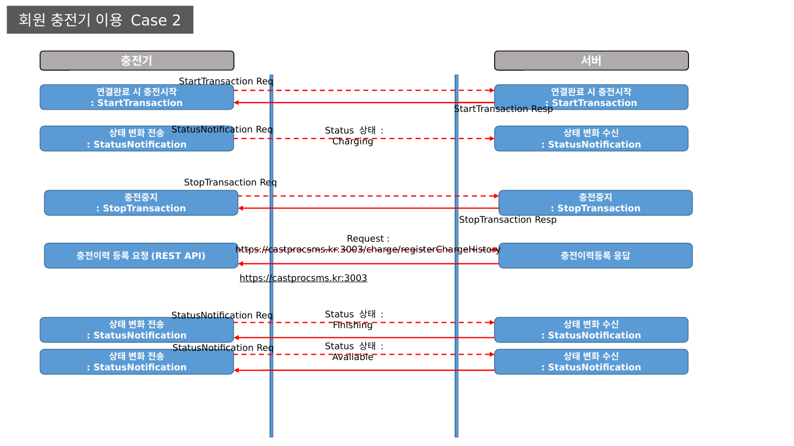
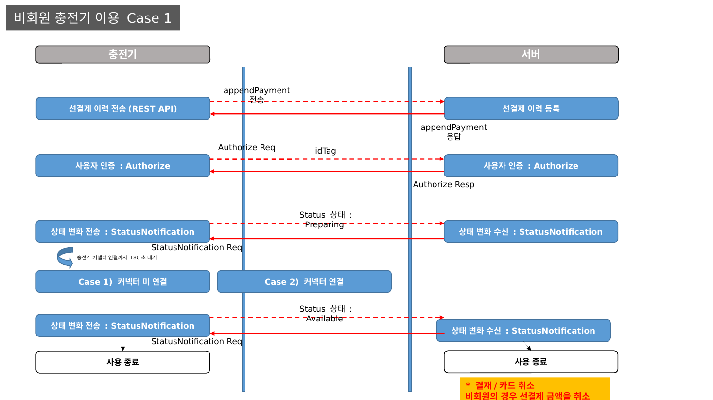
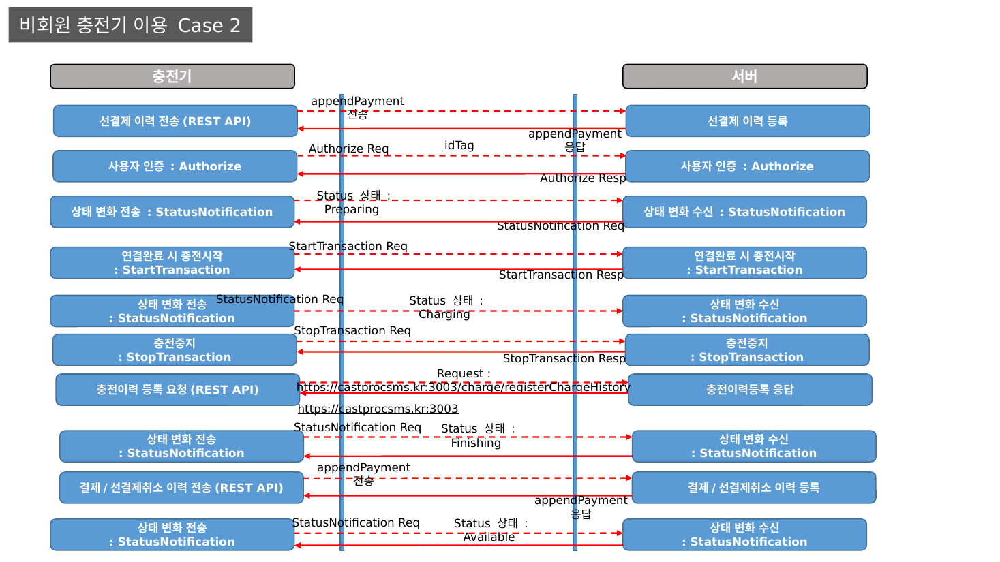
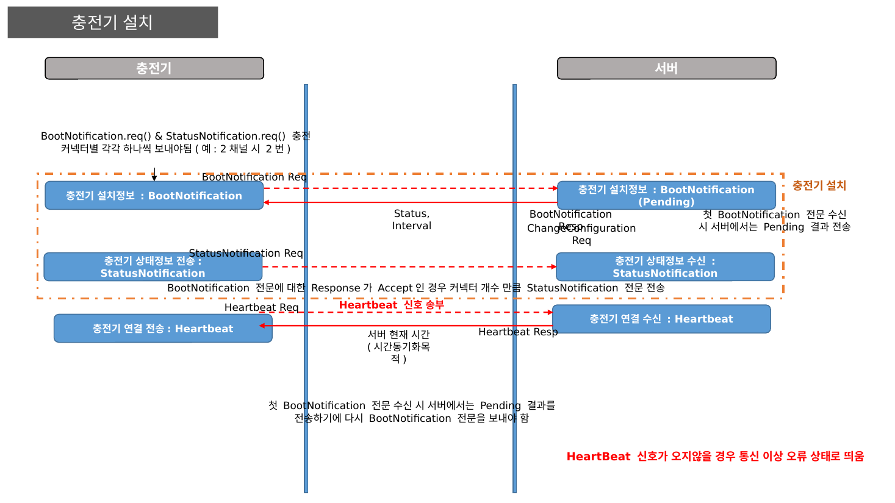
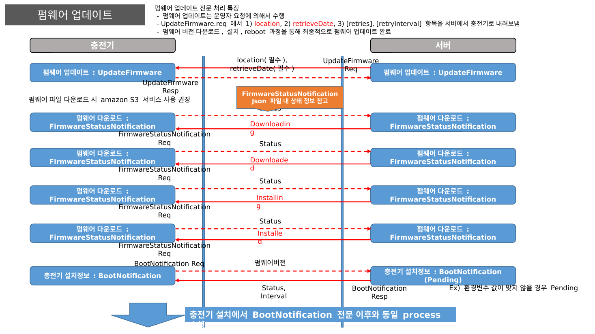
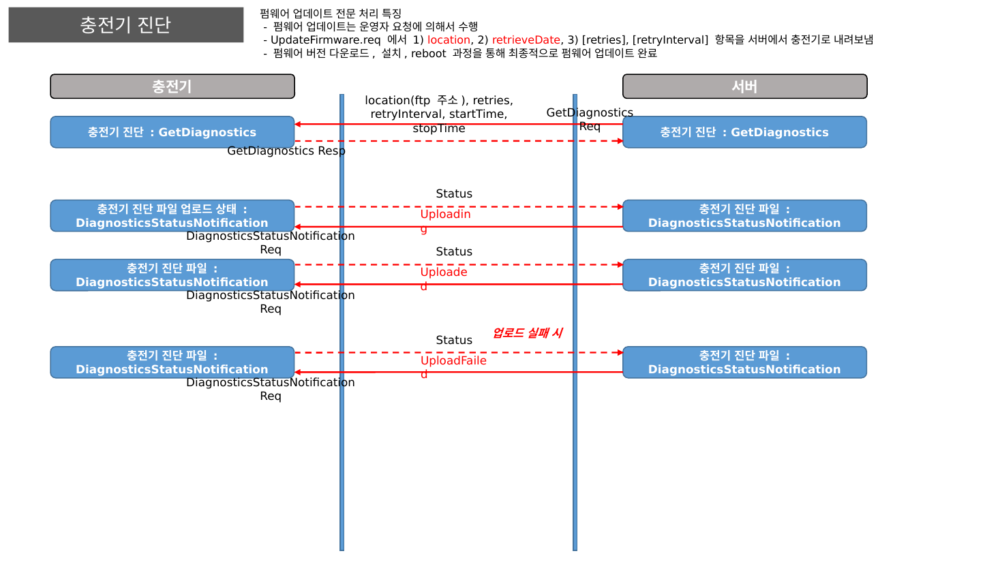

# OCPP 1.6 프로세스 정의

> 원본: `OCPP_1.6_프로세스정의_캐스트프로.pptx`
> 충전기 ↔ 서버 간 OCPP 메시지 시퀀스를 케이스별로 정리한 문서입니다. 각 메시지의 필드 명세는 [OCPP 1.6 WebSocket 메시지](messages.md)를 참고하세요.

## 목차

- [회원 충전기 이용 Case 1 — 커넥터 미연결](#회원-충전기-이용-case-1--커넥터-미연결)
- [회원 충전기 이용 Case 2 — 충전 진행](#회원-충전기-이용-case-2--충전-진행)
- [비회원 충전기 이용 Case 1 — 커넥터 미연결](#비회원-충전기-이용-case-1--커넥터-미연결)
- [비회원 충전기 이용 Case 2 — 충전 진행](#비회원-충전기-이용-case-2--충전-진행)
- [충전기 설치](#충전기-설치)
- [펌웨어 업데이트](#펌웨어-업데이트)
- [충전기 진단](#충전기-진단)

## 회원 충전기 이용 Case 1 — 커넥터 미연결

- `Authorize` 인증 후 `StatusNotification(Preparing)` 전송
- 180초 동안 커넥터 미연결 시 상태가 `Preparing` → `Available`로 변경
- 인증 후 `StartTransaction`이 아닌 `StatusNotification(Available)`이 오면 서버는 **사용 종료**로 인지

## 회원 충전기 이용 Case 2 — 충전 진행

- 커넥터 연결 완료 시 `StartTransaction` → `StatusNotification(Charging)`
- 충전 종료 시 `StopTransaction` → `StatusNotification(Finishing)` → `StatusNotification(Available)`
- 충전이력 등록 REST API 호출: `/charge/registerChargeHistory` ([충전이력 등록 REST API](../rest-api/charge-history.md))

## 비회원 충전기 이용 Case 1 — 커넥터 미연결

- `Authorize` 후 선결제 이력 전송(REST API, `appendPayment`)
- 커넥터 미연결로 `Available` 전환 시 **선결제 금액 취소** 후 사용 종료

## 비회원 충전기 이용 Case 2 — 충전 진행

- `Authorize` → 선결제 이력 전송(`appendPayment`) → `StartTransaction` → `StatusNotification(Charging)`
- 충전 종료 시 `StopTransaction` → 충전이력 등록 → 결제/선결제취소 이력 전송(`appendPayment`)
- 결제 관련 API는 [결제 REST API](../rest-api/payment.md) 참고

## 충전기 설치

- 첫 `BootNotification` 수신 시 서버는 `Pending`을 응답 → 충전기는 `BootNotification`을 다시 전송해야 함
- 응답이 `Accepted`이면 커넥터 개수만큼 `StatusNotification` 전송
- `BootNotification.req` / `StatusNotification.req`는 커넥터별로 각각 전송 (예: 2채널이면 2번)
- `Heartbeat` 응답의 서버 현재 시간으로 시간 동기화, Heartbeat가 오지 않으면 통신 이상 오류 상태로 표시

## 펌웨어 업데이트

- 운영자 요청에 의해 수행
- 서버 → 충전기 `UpdateFirmware.req`: `location`(필수), `retrieveDate`(필수), `retries`, `retryInterval`
- 충전기 → 서버 `FirmwareStatusNotification`: `Downloading` → `Downloaded` → `Installing` → `Installed`
- 다운로드·설치·재부팅 후 `BootNotification`부터 충전기 설치와 동일한 프로세스 수행
- 펌웨어 파일 다운로드 시 Amazon S3 사용 권장

## 충전기 진단

- 서버 → 충전기 `GetDiagnostics.req`: `location`(ftp 주소), `retries`, `retryInterval`, `startTime`, `stopTime`
- 충전기 → 서버 `DiagnosticsStatusNotification`: `Uploading` → `Uploaded` / `UploadFailed`
